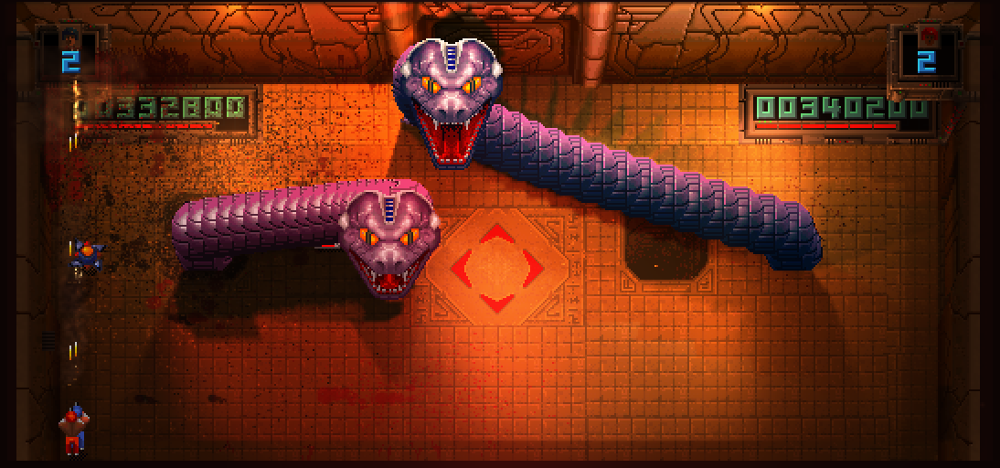
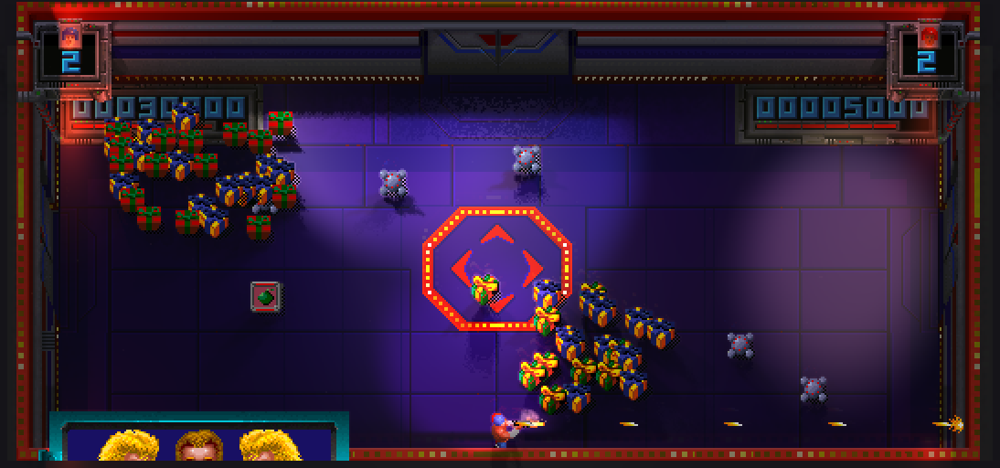
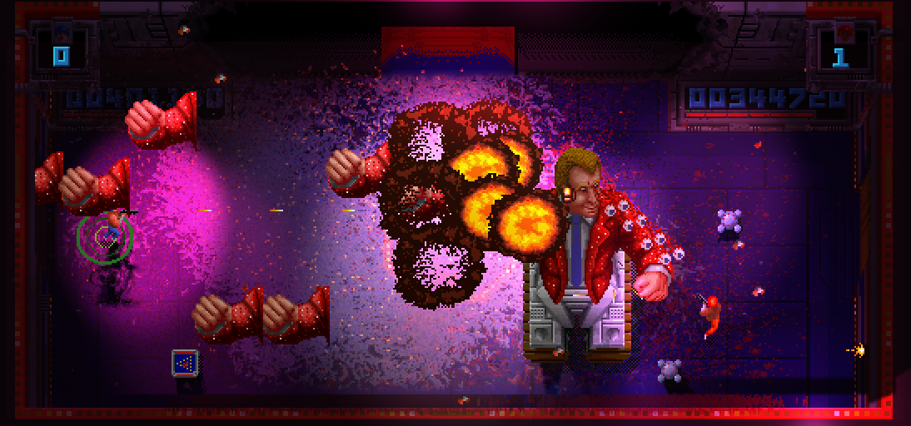

# Smash T.V. for Windows

Play Smash T.V. in its original 4:3 format or take on a rebalanced campaign in a shared 16:9 arena.

> [!IMPORTANT]
> Bring your own **Smash T.V. retail L8 arcade ROM set**. Setup uses your ROMs to build the native Windows player on your PC. The setup package contains no game ROMs, extracted graphics or sound, or prebuilt game executable.

| Mutoid Man | Scarface | Cobra |
| --- | --- | --- |
|  |  |  |

| Bonus Prizes arena | Final Mutoid Man |
| --- | --- |
|  |  |

## PC enhancements

- **Classic 4:3 and Widescreen 16:9.** Choose Classic for the original arcade playfield and difficulty, or Widescreen for wider combat arenas at the original sprite scale. Each mode keeps its own high scores.
- **Rebalanced widescreen campaign.** Faster movement, larger enemy waves and longer-lasting weapon pickups change how you use the extra space. Waves and boss fights are tuned for solo and two-player runs, with Widescreen designed to be the tougher challenge.
- **Analog movement and aiming.** Move with the left stick and aim independently with the right so you can fire into a crowd while retreating or circling it. Keyboard and controller bindings are remappable.
- **Widescreen dash.** Tap the left trigger (LT) for a short burst in your movement direction. Two tinted afterimages trail the dash as you clear a gap in the crowd. Both players can dash, each with a short cooldown.
- **Online multiplayer with public lobbies.** Open **Multiplayer** to host a two-player game or browse public rooms by ping. Leave the second seat open, protect it with a password, or open a solo run to a partner mid-game. Couch co-op, LAN rooms and direct-IP play are also available.
- **Custom dynamic lighting for every combat room.** Optional hardware ray tracing (DXR) adds lighting and shadows across the arena. Per-room color grading, weapon trails, impact debris and distinct boss attack and explosion smoke give each fight its own look. Reduced-flash and reduced-motion settings let you tone down the effects.
- **More sound channels.** Enable extra sound boards to hear the announcer over sustained gunfire without cutting the shots short. Stereo and reverb are optional, and the original arcade mono mix is available.
- **PC display options.** Choose fullscreen, integer scaling, smooth camera motion, and modern or CRT presets.

## Play

On Windows x64, extract the release ZIP. In [RecompLauncher](https://recomplauncher.com), use Easy Setup and select your retail L8 ROM ZIP. For standalone setup, open `SmashTV.exe` and select the same ZIP. Setup builds a native player locally from your copy.

Merged and non-merged sets are supported. For a split set, keep the parent `smashtv.zip` and clone ZIPs in the same folder during setup. The importer checks the chip contents for the L8 program, graphics and sound.

## Build from source

Run `.\build.ps1 -Mode MSVC -Rom "C:\path\to\your-L8.zip"` from PowerShell with Visual Studio C++ tools, the Windows SDK, CMake, Ninja, and Python available. For a source-only checkout, restore the pinned graphics runtime dependencies listed in [the graphics manifest](tools/release/graphics-files.json) before building. The Windows build also requires the Epic Online Services C SDK 1.19.2.1 under `build/dependencies/eos/1.19.2.1/SDK` and a game-client configuration at `build/dependencies/eos/eos-client.ini`. Set `SDL3_DIR` to the SDL3 CMake package directory to enable SDL gamepad support. The main and sound programs are translated ahead of time.

## Credits and license

Smash T.V. is the original arcade game by Williams Electronics Games, Inc. This unofficial Windows port uses static recompilation to run the retail main and sound programs as native code. Development used AI-assisted coding tools, automated tests, execution traces and gameplay captures. MAME 0.289 serves as the reference for comparing arcade behavior.

Thanks to Aaron Giles for **ymfm**, which provides FM sound synthesis, and to Sebastian Toyos for **tmnt-port** and **arcade-lan**, adapted here for PC menus, settings and multiplayer room discovery. Public online lobbies use Epic Online Services.

The original game code, artwork and audio remain the property of their respective rights holders. The source distribution grants no permission to redistribute those materials or the player built from them. Third-party components retain their own licenses. [Third-party credits and license notices](THIRD_PARTY_NOTICES.md)
