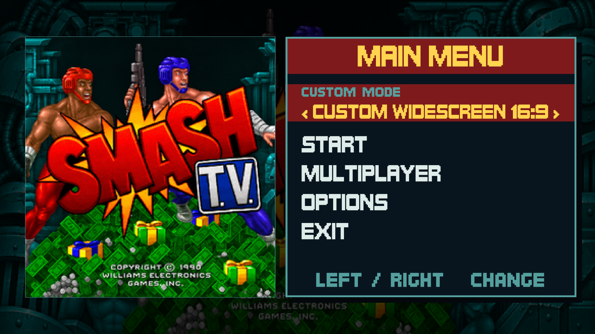
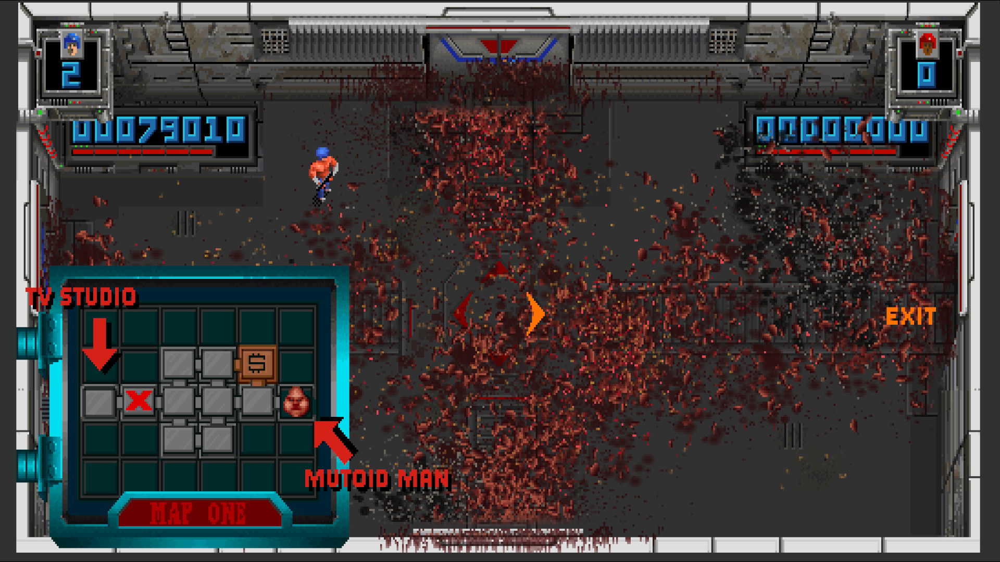

<p align="center">
  
</p>

# Smash TV for Windows

A native Windows port of the retail L8 arcade game, built ahead of time from
your own ROM set. Play the original 4:3 presentation or the shared-screen 16:9
mode, with twin-stick controls, local co-op, PC display/audio options, and
optional modern visual effects.

> [!IMPORTANT]
> **No ROMs, program code, graphics, sound data, or ready-to-run proprietary
> game content are included in this repository.** A legally obtained retail L8
> Smash TV ROM ZIP is required to import and build the player. Generated C++,
> translated executables, and imported caches contain original game material and
> must not be uploaded or redistributed.

The main and sound programs are translated to native C++ ahead of time. The
player contains no runtime CPU interpreter, JIT, MAME, RetroArch, or emulator
fallback.

## Screenshots

| Main menu | Widescreen gameplay |
| --- | --- |
|  |  |

<p align="center">
  
</p>

## Features

### Gameplay

- **Two playfield modes**
  - Arcade Original: original 4:3 geometry and arcade gameplay behavior.
  - Custom Widescreen: shared 16:9 arena with the original sprite scale.
- **One- and two-player local co-op** with independent keyboard or XInput
  controls.
- **Native retail program and sound flow** for boot, attract, operator screens,
  audio, credits, start, continue, scoring, rooms, bosses, and CMOS storage.
- **LAN and direct-IP co-op** through the included room flow and rollback
  transport.
- **Modern input handling** with two-pad support, remapping, dead zones, swap
  order, hotplug recovery, and controller-operated menus.

### Presentation

- Fullscreen and windowed modes with exact scaling, integer scaling, nearest,
  linear, sharp, and CRT-style output.
- Smooth camera motion, optional run-ahead, VSync, uncapped presentation, and
  separate render/game-rate counters.
- DXR 1.1 room lighting with world-anchored shadows, moving show lighting,
  boss keys, and gameplay explosion lights.
- Persistent blood, oil, debris, smoke, particles, brass, muzzle flashes,
  tracers, shockwaves, enemy destruction, wet materials, and weapon impacts.
- GPU-resident composition with original HUD/protected pixels kept above the
  cosmetic layer.
- Modern clean and CRT Guest Advanced, CRT Royale, and CRT Lottes shader
  presets, plus optional bloom, sharpening, and tube curvature.

### Audio

- Native translated sound-board execution with original music, speech, and
  effects.
- WASAPI shared output, device-loss recovery, and bounded output drift handling.
- Master volume, mute, extended sound channels, studio/arena reverb, stereo
  width, and hi-fi output controls.

## Requirements

- Windows 10 or Windows 11 x64
- A retail L8 Smash TV ROM ZIP supplied by the player
- Visual Studio C++ x64 tools
- CMake
- Ninja
- Python 3.11 or newer
- A DXR 1.1-capable GPU for optional hardware ray tracing

## First run

1. Start **Play Smash TV.cmd** or run the development player.
2. Select the retail L8 ROM ZIP.
3. The importer validates the required chip contents and creates a private
   cache under `%LOCALAPPDATA%\SmashTV`.
4. Choose **Arcade Original** or **Custom Widescreen**, then select **Start**.
5. Press **5** to insert a Player 1 coin and **1** to start. Player 2 uses **6**
   and **2**.

Split sets may remain split, but keep the parent and clone ZIPs together for the
first import. The source ZIP can be moved after a successful import.

## Controls

| Action | Player 1 | Player 2 |
| --- | --- | --- |
| Move | W A S D | I J K L |
| Fire | Arrow keys | Numpad 8 4 5 6 |
| Coin | 5 | 6 |
| Start | 1 | 2 |

Controllers use the left stick/D-pad to move and the right stick to fire.
Back inserts a coin and A starts by default. **Esc** or **F1** opens the pause
menu; **F11** toggles fullscreen. Remapping is under **Options > Controls**.

## Build

```powershell
.\build.ps1 -Rom 'C:\path\to\smashtv.zip'
.\test.ps1
```

The selected-ROM player is written to `build/rom-player/SmashTV.exe`.
Generated and imported outputs stay local and ignored by Git. See the project
Issues and Discussions tabs for qualification work and release blockers.

## Legal and credits

Smash TV and its original assets are owned by their respective rights holders.
This project is not affiliated with or endorsed by them. The repository does
not grant any license to the original game data.

The Windows frontend adapts applicable PC features from
[tmnt-port](https://github.com/cheviman/tmnt-port) and
[arcade-lan](https://github.com/cheviman/arcade-lan). CRT shader, audio, build,
and platform dependencies keep their upstream notices. See
[`THIRD_PARTY_NOTICES.md`](THIRD_PARTY_NOTICES.md) for the complete list.
