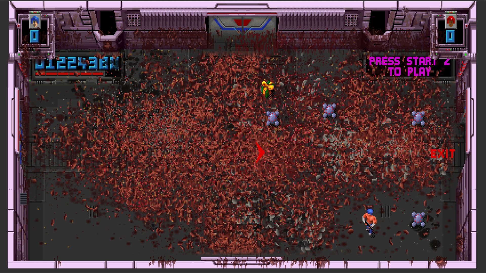

# SmashPort: Smash TV for Windows



A native Windows x64 version of the retail L8 *Smash T.V.* arcade game: the arcade original, with uncapped display frame rates. Smooth Motion pans the camera between arcade frames while the game itself keeps exact arcade speed. Play in the original 4:3 arena or in shared-screen 16:9, and turn on as many enhanced graphics options as you like: persistent blood and gore, debris and destruction, smoke and fire, muzzle flash and tracers, room lighting with optional hardware ray tracing, and CRT filters.

## Recent changes

- Drop-in/drop-out online and LAN play: join a game in progress as player 2, leave any time
- Extended sound channels: the announcer no longer cuts off gunfire, and every sound plays together
- New audio options: reverb (Studio or Arena), wide stereo and hi-fi output
- Chrome metal debris and engine-oil spray from machine enemies
- Mutoid tanks no longer freeze against walls in 16:9
- One `SmashTV.exe`: it installs, asks for your ROM, builds and launches

The download contains no game data. On first launch it asks for **your own** retail L8 ROM ZIP and builds the game on your PC from that ROM's main and sound programs. Nothing is emulated at run time.

## Play

1. Download the latest Windows x64 ZIP from [Releases](https://github.com/meathax/smashport/releases) and extract it.
2. Run **SmashTV.exe** and select your retail L8 ROM ZIP (merged, split or non-merged sets work). The first build takes under a minute.
3. Later launches start the game directly. Hold **Shift** while launching, or pass `--select-rom`, to choose a different ROM.

| | Player 1 | Player 2 |
| --- | --- | --- |
| Move | W A S D | I J K L |
| Fire | Arrow keys | Numpad 8 4 5 6 |
| Coin / Start | 5 / 1 | 6 / 2 |

Controllers: the left stick moves and the right stick fires. **Back** inserts a coin and **A** starts. **Esc** or **F1** opens the menu, and **F11** toggles fullscreen.

## Online and LAN multiplayer

Open **Multiplayer** to host or join a public Epic Online Services room, or use **LAN and direct connections**. No Epic account is needed.

- **Drop-in:** pick a room and you enter the game already in progress as player 2, as if you had put in a coin.
- **Drop-out:** leave at any time. Your character dies and the host keeps playing. The room stays open for the next player.
- **Netcode:** rollback with no added input delay, frame-advantage time sync, and automatic resync if the two PCs diverge.

## Build from source

The release is built by `tools/release/installer/build.py`, which produces the single `SmashTV.exe`. You need:

- An LLVM-MinGW (clang 22) toolchain with an embedded Python 3.12 (`--llvm`)
- Epic Online Services SDK 1.19.2.1 (`--eos`) and an `eos-client.ini` holding your product's five client settings (`--config`)
- DirectX Shader Compiler `dxc.exe` (`--dxc`)
- librashader, librashader-d3d11 and dxcompiler DLLs placed at the paths listed in `tools/release/graphics-files.json`, matching its SHA-256 hashes (sources are in each `PROVENANCE.json`)

```powershell
python tools/release/installer/build.py --output C:\out\SmashTV.exe --llvm <toolchain> --eos <EOS SDK> --config <eos-client.ini> --dxc <dxc.exe>
```

This repository holds source code and one README screenshot. ROMs, translated game code and binaries are never committed.

## Credits and licenses

Smash T.V. is a trademark of its respective owner. This project is not affiliated with or endorsed by it. You must own the ROM you use.

Third-party code keeps its own license, found beside it in `third_party/`. See [THIRD_PARTY_NOTICES.md](THIRD_PARTY_NOTICES.md).

- [ymfm](https://github.com/aaronsgiles/ymfm) (BSD-3-Clause): YM2151 sound
- [tmnt-port](https://github.com/cheviman/tmnt-port) and [arcade-lan](https://github.com/cheviman/arcade-lan): PC frontend and LAN lobby work
- [librashader](https://github.com/SnowflakePowered/librashader) (MPL-2.0 / GPL-3.0) and slang CRT shaders: video filters
- [MAME](https://github.com/mamedev/mame) (BSD-3-Clause portions): sound board device and scheduler behaviour
- Epic Online Services SDK: online rooms
