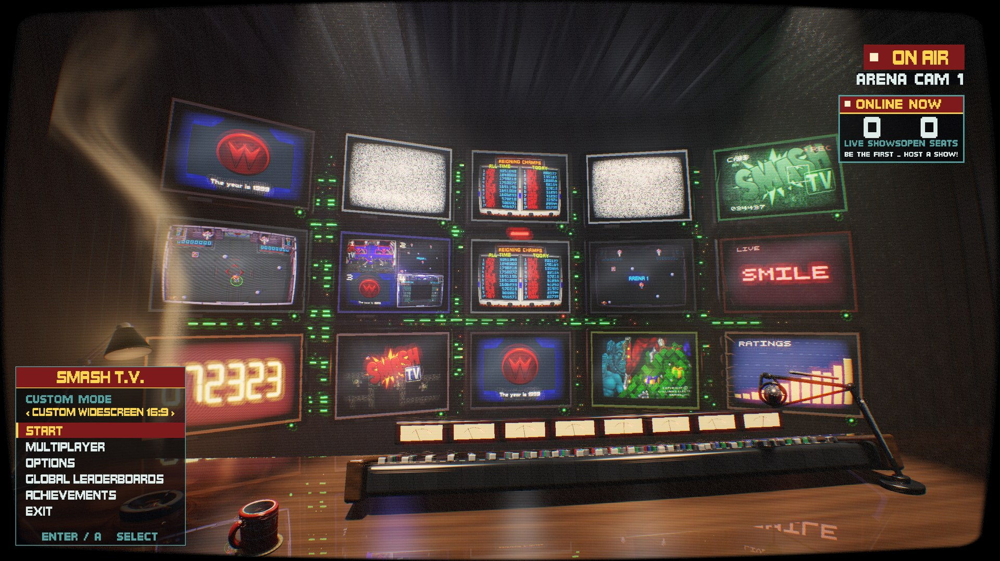
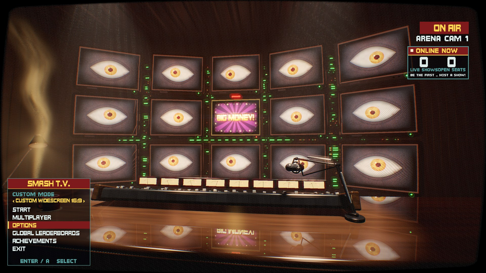
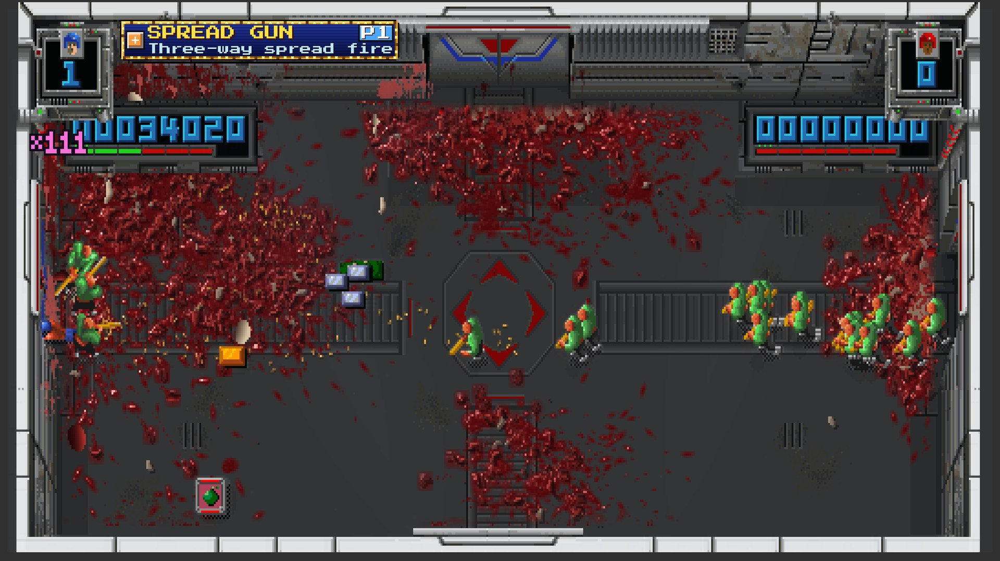
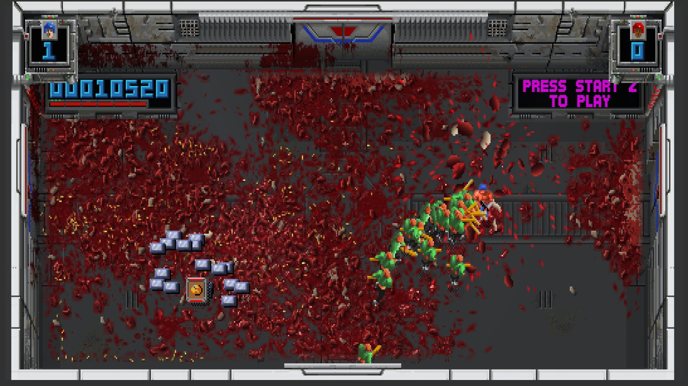
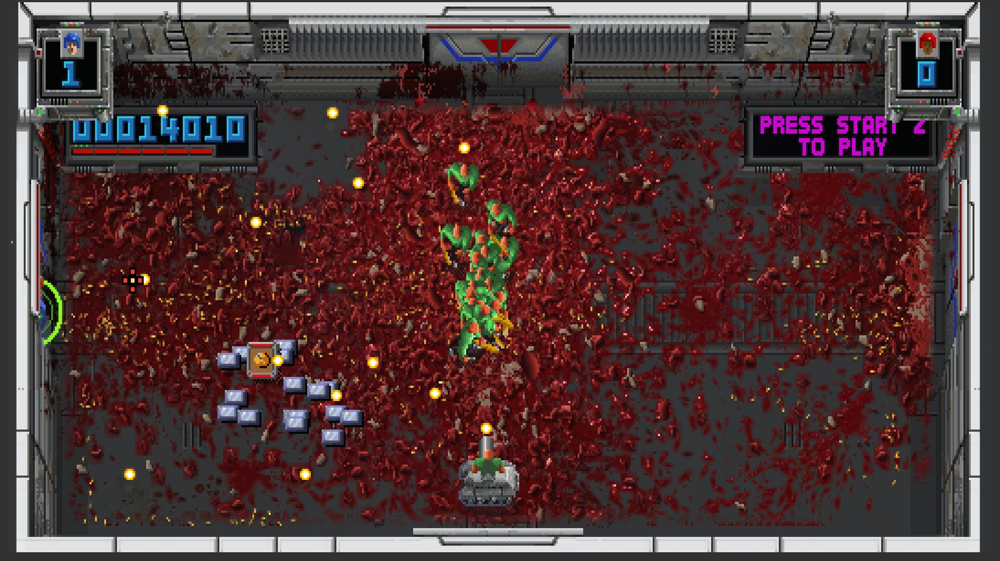
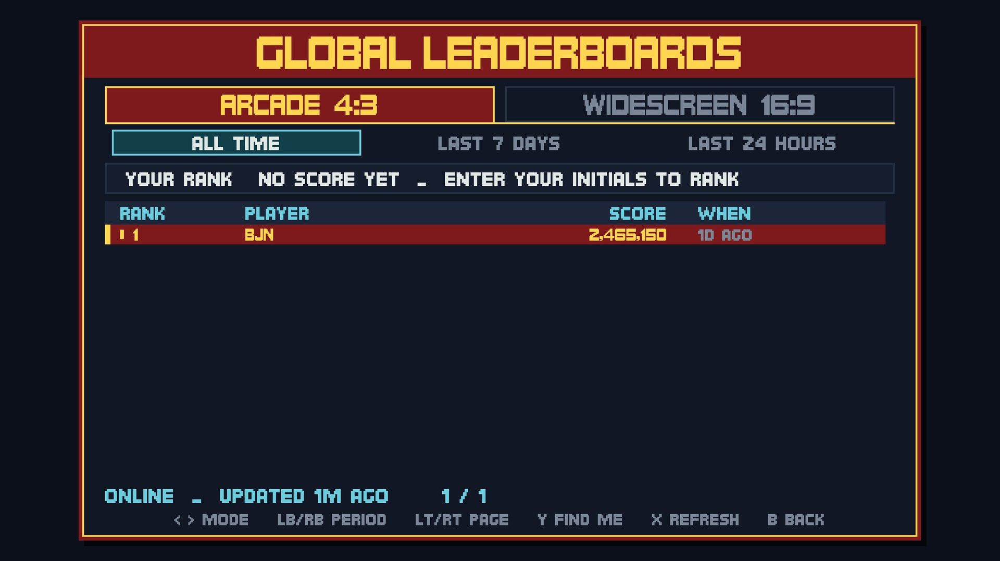

# Smash T.V. Widescreen Recomp

A native Windows remaster of the arcade classic: original 4:3 or a rebalanced shared 16:9 arena, with modern lighting, persistent gore and online play.

> [!IMPORTANT]
> Bring your own **Smash T.V. retail L8 arcade ROM set**. Setup builds the native player on your PC from your ROMs. The download contains no ROMs, game art, sound or prebuilt game executable.

| | |
| --- | --- |
|  |  |
|  |  |
|  |  |

## Key features

- **Widescreen 16:9 campaign** - wider arenas at original sprite scale, faster movement, bigger waves, retuned bosses. Classic 4:3 stays arcade-exact. Separate high scores per mode.
- **New weapon variants** - rare pickup rolls like Ricochet Rounds, Napalm grenades, Twin Seekers and Bulldozer Boots, each announced on pickup (Widescreen).
- **Live TV-studio main menu** - a broadcast booth whose monitors show live bot play and the global leaderboard, with the original theme.
- **Persistent gore** - blood pools, dries and layers; gibs, footprints, wall spray, scorch marks.
- **Global online leaderboards** - all-time, 7-day and 24-hour boards per mode, replay-verified. Only the current release posts scores.
- **Online multiplayer** - public lobbies, passworded rooms, drop-in partners, LAN, direct IP and couch co-op.
- **Dynamic lighting** - optional DXR ray tracing, per-room grading, muzzle flashes, ejected brass, boss smoke. Every effect has its own toggle, plus reduced-flash/motion modes.
- **Twin-stick controls** - analog move and aim, fully remappable keyboard and controller.
- **Better audio** - extra sound channels so the announcer never cuts gunfire, optional stereo and reverb, or the original mono mix.
- **Native code** - main and sound programs statically recompiled; no emulator, no interpreter.

## Play

Windows x64: extract the release ZIP, then use Easy Setup in [RecompLauncher](https://recomplauncher.com) or run `SmashTV.exe` and pick your L8 ROM ZIP. Merged, non-merged and split sets work under any file name. Later releases rebuild in place from the ROM copy kept by your first setup.

**Portable mode:** put an empty `portable.txt` next to `SmashTV.exe` (or run `SmashTV.exe --portable`). Everything then lives in a `data` folder beside the exe. Don't use it under Program Files.

## Build from source

`.\build.ps1 -Mode MSVC -Rom "C:\path\to\your-L8.zip"` with Visual Studio C++ tools, Windows SDK, CMake, Ninja and Python. Source-only checkouts also need the pinned [graphics dependencies](tools/release/graphics-files.json), the EOS C SDK 1.19.2.1 in `build/dependencies/eos/1.19.2.1/SDK` with `build/dependencies/eos/eos-client.ini`, and SDL3 3.2.24 in `build/platform-sdk/SDL3-3.2.24` (or `SDL3_DIR`) for gamepads; without it the build uses XInput only.

## Credits and license

Smash T.V. is by Williams Electronics Games, Inc. This is an unofficial port built with AI-assisted coding, automated tests and MAME 0.289 as the behavior reference. Thanks to Aaron Giles (**ymfm**) and Sebastian Toyos (**tmnt-port**, **arcade-lan**). Online lobbies use Epic Online Services.

The original code, art and audio belong to their rights holders; this source grants no right to redistribute them or the player built from them. Third-party components keep their own licenses: [notices](THIRD_PARTY_NOTICES.md).
