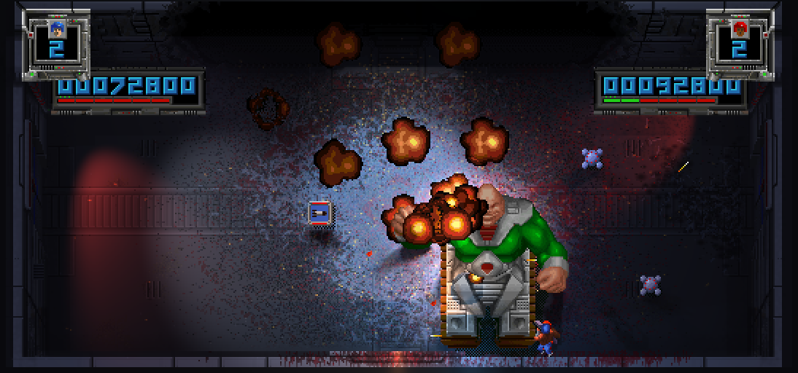
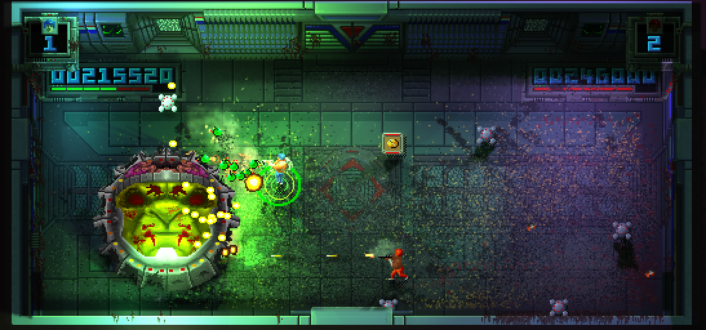

# Smash T.V. for Windows

Native arcade action from your own retail L8 ROM ZIP. Play in the original 4:3 format or take on a rebalanced campaign in a shared 16:9 arena.

| Mutoid Man | Scarface | Cobra |
| --- | --- | --- |
|  |  |  |

| Bonus Prizes arena | Final Mutoid Man |
| --- | --- |
|  |  |

## What the PC port adds

- **Custom widescreen.** Wider arenas at the original sprite scale, faster movement, growing enemy waves, and longer-lasting weapon pickups.
- **Two-player twin-stick play.** Local co-op, LAN and direct IP, with remappable keyboard and pad controls.
- **Optional enhanced effects.** DXR lighting, dynamic shadows, smoke, debris, impact effects, and reduced-motion and reduced-flash settings.
- **PC display options.** Fullscreen, integer scaling, smooth camera motion, and modern and CRT presets.
- **Arcade Original.** The original 4:3 playfield, progression, scoring, operator menus, and sound from your L8 import.

## Play

On Windows x64, extract the release ZIP. In [RecompLauncher](https://recomplauncher.com), use Easy Setup and select your retail L8 ROM ZIP. For standalone setup, open `SmashTV.exe` and select the same ZIP. Setup builds a native player locally from your copy.

## Build from source

Run `.uild.ps1 -Mode MSVC -Rom "C:path	oyour-L8.zip"` from PowerShell with Visual Studio C++ tools, the Windows SDK, CMake, Ninja, and Python available. For a source-only checkout, restore the pinned graphics runtime dependencies listed in [the graphics manifest](tools/release/graphics-files.json) before building. The main and sound programs are translated ahead of time.

Smash T.V. belongs to its rights holders. Release packages contain the setup tools and dependencies. See [third-party notices](THIRD_PARTY_NOTICES.md).
